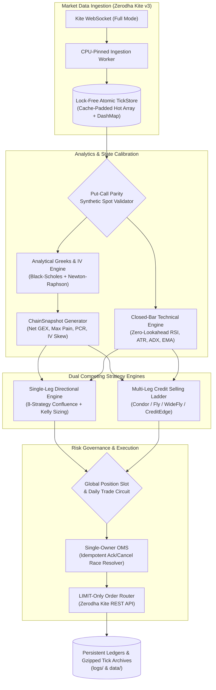

<h1 align="center">Satavahana</h1>

<p align="center">
  <strong>High-Performance, Low-Latency Quantitative Trading & Market Microstructure Framework for Indian Derivatives (NSE / NFO)</strong>
</p>

<p align="center">
  <a href="#overview"></a>
  <a href="#architecture"></a>
  <a href="#core-engines"></a>
  <a href="#analytical-greeks--gex-surface"></a>
  <a href="#empirical-research--backtesting"></a>
  <a href="#quick-start"></a>
</p>

---

## Overview

**Satavahana** is an institutional-grade, zero-allocation quantitative trading framework and runtime engine engineered in Rust for the National Stock Exchange of India (NSE). Designed for low-latency intraday derivatives trading, Satavahana interfaces with **Zerodha Kite Connect v3**, ingesting full-mode market depth across up to 3,000 options contracts concurrently, computing real-time analytical Greeks, dynamic Gamma Exposure (GEX) surfaces, and executing competing systematic strategies through a shared single-owner Order Management System (OMS).

The framework prioritizes computational efficiency, zero look-ahead bias, fee-inclusive financial modeling, and strict mathematical anti-overfitting discipline.

### Why Satavahana?

* ⚡ **Sub-Millisecond Tick-to-Decision**: Built with cache-padded atomic arrays (`TickStore`) pinned to dedicated CPU cores, bypassing heap allocations in the hot path.
* 🛡️ **Dual Competing Engine Architecture**: Houses both a directional premium-buying engine (8-strategy confluence) and a systematic multi-leg credit-selling engine (Iron Condor, Iron Fly, Credit Edge) that compete for a single global position slot.
* 📐 **Robust Surface Calibration**: Real-time Black-Scholes analytical Greeks with Newton-Raphson implied volatility solvers, Put-Call parity synthetic spot verification, and dealer Net GEX profiling.
* 🔬 **Friction-Aware Financial Reality**: Native calculation of all Indian exchange levies (STT, exchange turnover fees, SEBI charges, stamp duty, GST, and broker commissions) at every step of signal generation and backtesting.
* 📊 **High-Fidelity Deterministic Replay**: Capable of replaying millions of multi-strike `.csv.gz` ticks with sub-second wall-clock alignment and millisecond broker acknowledgement latency modeling.

---

## System Architecture



---

## Core Engines

### 1. Single-Leg Directional Engine (`src/options_engine.rs`)
The directional engine searches for high-probability option buying opportunities (CE/PE) using an 8-factor confluence stack combined with fractional Kelly capital allocation:
* **Confluence Evaluator**: Aggregates signals from Open Interest flow, order book imbalance, volume acceleration, dynamic support/resistance, RSI trend alignment, and implied volatility percentile.
* **Structural Gate Stack**:
  * *Frozen Tape Detector*: Verifies that spot and strike ticks have not stalled.
  * *Put-Call Parity Validator*: Ensures the underlying index token has not diverged from synthetic parity spot ($S = K \cdot e^{-rT} + C - P$).
  * *Regime Filter*: Adapts thresholds based on 8 discrete volatility states (Panic/High-Vol, Low-Vol Complacency, Bullish, Bearish, Neutral).
  * *Risk-Reward Gate*: Enforces minimum ex-ante risk-reward ratios ($\ge 1.30$).

### 2. Multi-Leg Credit Selling Ladder (`src/multileg.rs`)
The systematic option-selling engine harvests volatility risk premia across defined-risk credit structures:
* **Structure Ladder**: Automatically evaluates and selects between **Iron Condor**, **Iron Fly**, **Wide Iron Fly**, and **Credit Edge (Vertical Spreads)** based on the opening range extension and implied volatility term structure.
* **Opening Range Admissions**: Enforces entry balance bounds (`CREDIT_EDGE_MAX_ENTRY_BALANCE = 0.86`) to reject selling into runaway gap opens.
* **Dynamic Hedging & Leg Balancing**: Calibrates short strikes near $0.30\Delta$ and wings sized to account margin constraints (SPAN margin aware).

### 3. Order Management System & Safety Circuits (`src/oms.rs`, `src/portfolio.rs`)
* **Shared Position Lock**: Ensures that the two competing engines never collide or over-leverage the account. The daily trade cap (default: 1 trade/day) halts further entry once a fill is registered.
* **Idempotent Order Handling**: Handles broker race conditions where orders are acknowledged while market conditions invalidate the signal, automatically managing cancels and stale fill auto-flattening.
* **Feed-Staleness Watchdog**: Flattens open positions immediately if market data feeds disconnect during active market hours.

---

## Analytical Greeks & GEX Surface

Satavahana performs on-the-fly valuation for the entire active options chain on every scan cycle:

$$\text{Net GEX} = \sum_{i} \left( \Gamma_{\text{CE}, i} \cdot \text{OI}_{\text{CE}, i} - \Gamma_{\text{PE}, i} \cdot \text{OI}_{\text{PE}, i} \right) \cdot S \cdot \text{LotSize}$$

| Metric | Computation | Function |
| :--- | :--- | :--- |
| **Spot Parity Guard** | Synthetic spot via put-call parity vs token LTP | Guards against exchange feed latency or corrupted spot index ticks |
| **IV Solver** | Newton-Raphson inversion with Black-Scholes seeds | Evaluates contract volatility with $0.0$ fallback protection |
| **IV Skew** | $\text{IV}_{\text{CE}} - \text{IV}_{\text{PE}}$ at matching delta | Measures directional fear/greed skew in real-time |
| **Max Pain** | $\arg\min_K \sum \text{Payout}(K)$ | Identifies expiry writer pin zones |
| **Net GEX** | Gamma-weighted Open Interest balance | Quantifies dealer hedging acceleration boundaries |

---

## Library API Examples

Satavahana is designed both as a standalone trading runtime binary and as a modular Rust crate.

### 1. Ingesting Ticks & Reading the Lock-Free Store

```rust
use satavahana::store::TickStore;
use satavahana::models::Tick;

// Initialize high-performance tick store
let store = TickStore::new();

// Ingest incoming WebSocket full tick
store.update_from_tick(&incoming_tick);

// O(1) lock-free read on hot instrument tokens
if let Some((token, ltp)) = store.get_hot_tick(NIFTY_INDEX_TOKEN) {
    println!("NIFTY Spot LTP: {:.2}", ltp);
}
```

### 2. Evaluating Analytical Greeks & Surface Metrics

```rust
use satavahana::greeks::{black_scholes_greeks, implied_volatility, OptionType};

let spot = 24500.0;
let strike = 24500.0;
let time_to_expiry_years = 4.0 / 365.0; // 4 DTE
let risk_free_rate = 0.065;           // 6.5% RBI repo rate
let market_price = 185.50;

// Solve for Implied Volatility
let iv = implied_volatility(
    market_price,
    spot,
    strike,
    time_to_expiry_years,
    risk_free_rate,
    OptionType::Call,
).unwrap_or(0.0);

// Compute complete Greek vector
let greeks = black_scholes_greeks(
    spot,
    strike,
    time_to_expiry_years,
    risk_free_rate,
    iv,
    OptionType::Call,
);

println!("Delta: {:.4}, Gamma: {:.6}, Theta: {:.2}, Vega: {:.2}", 
    greeks.delta, greeks.gamma, greeks.theta, greeks.vega);
```

### 3. Running an Options Backtest from Gzipped Ticks

```rust
use satavahana::backtest::OptionsReplayRunner;
use std::path::Path;

let runner = OptionsReplayRunner::builder()
    .tick_data_path(Path::new("data/2026-08-25_options_ticks.csv.gz"))
    .starting_capital(15_000.0)
    .scan_interval_secs(30)
    .build()?;

let session_result = runner.run()?;
println!("Session P&L: ₹{:.2} | Trades: {}", 
    session_result.net_pnl, 
    session_result.total_trades);
```

---

## Quick Start

### Prerequisites
* **Rust**: `1.75+` (stable)
* **Operating System**: Linux (Ubuntu 22.04+ recommended) or macOS (Apple Silicon / Intel)
* **Zerodha Kite Connect Account**: API Key, API Secret, and active TOTP authentication.

### Installation

```bash
# Clone the repository
git clone https://github.com/Abhinaykrishna2/satavahana.git
cd satavahana

# Build the release binary and backtest tools
cargo build --release
```

### Configuration

Copy the example configuration file and enter your Zerodha credentials:

```bash
cp config/config.toml.example config/config.toml
```

Edit `config/config.toml`:
```toml
[kite]
api_key = "your_kite_api_key"
api_secret = "your_kite_api_secret"
redirect_url = "http://127.0.0.1:8080"

[trading]
symbol = "NIFTY"
strike_range_pct = 0.04
scan_interval_secs = 30
max_trades_per_day = 1
```

### Execution Modes

```bash
# 1. Paper Trading Mode (Default: simulated execution against real live WebSocket tape)
cargo run --release --bin satavahana

# 2. Live Trading Mode (Requires explicit confirmation flag)
cargo run --release --bin satavahana -- --live

# 3. High-Fidelity Historical Replay Backtest
cargo run --release --bin backtest_options -- \
    --ticks data/2026-08-25_options_ticks.csv.gz \
    --capital 15000 \
    --scan-interval 30

# 4. Multi-Leg Credit Strategy Backtest
cargo run --release --bin backtest_multileg -- \
    --ticks data/2026-08-25_option_selling_ticks.csv.gz
```

---

## Repository Structure

```
satavahana/
├── Cargo.toml                    # Root workspace manifest
├── config/
│   └── config.toml.example       # Annotated configuration template with risk parameters
├── docs/
│   └── cmd.txt                   # Operational commands, CLI flags, and deployment guide
├── memory_backtest.md            # Empirical research log, walk-forward records & rejected hypotheses
├── src/
│   ├── Cargo.toml                # Core package manifest & dependency graph
│   ├── lib.rs                    # Public library interface & module exports
│   ├── main.rs                   # Primary runtime orchestrator & CLI entrypoint
│   ├── auth.rs                   # Kite Connect v3 OAuth, TOTP, and token cache validation
│   ├── capital.rs                # Dynamic capital allocation & live margin synchronization
│   ├── greeks.rs                 # Black-Scholes analytical Greeks & IV numerical solvers
│   ├── microbook.rs              # L2-L5 depth book parser & microstructural flow signals
│   ├── multileg.rs               # Multi-leg credit selling ladder (Condor, Fly, Credit Edge)
│   ├── multileg_replay.rs        # Deterministic multi-leg backtest engine
│   ├── oms.rs                    # Single-owner Order Management System & state machine
│   ├── options_engine.rs         # Single-leg directional engine & 8-strategy confluence
│   ├── portfolio.rs              # Shared position circuit breaker & daily loss caps
│   ├── risk.rs                   # Pre-trade margin preflight, SPAN estimation, and sizing
│   ├── store.rs                  # Lock-free atomic TickStore with cache-padded lines
│   ├── technicals.rs             # Closed-bar technical indicators (Zero look-ahead bias)
│   ├── websocket.rs              # Binary WebSocket parser for Kite Connect v3
│   └── bin/
│       ├── backtest_options.rs   # Single-leg high-fidelity tick backtester
│       ├── backtest_multileg.rs  # Defined-risk credit ladder backtester
│       ├── backtest_equity.rs    # Equity spread replay runner
│       └── backtest_quant.rs     # Statistical arbitrage simulation runner
```

---

## Empirical Research & Discipline

Satavahana operates under strict quantitative research principles:

1. **Accept the Tail as the Cost of the Edge**: On defined-risk option selling ($0.30\Delta$), short delta approximates the risk-neutral probability of expiring In-The-Money ($\approx 22\%$ loss rate). Interventions that attempt to filter structural losses without sufficient out-of-sample statistical power routinely damage net expectancy.
2. **Zero-Lookahead Verification**: Technical indicators consume only closed time bars. In-progress price formation never leaks into signal decisions.
3. **Friction Inclusiveness**: Strategy candidates must clear complete exchange transaction costs and slippage before being promoted to live evaluation.
4. **Sample-Size Invariance**: We reject candidate filters fitted to small sample sizes ($<100$ trades), avoiding the trap of curve-fitting to noise.

---

## License & Disclaimer

**Disclaimer**: *Satavahana is experimental quantitative software intended for research and educational purposes. Financial derivatives trading involves substantial risk of loss. Past backtested performance is no guarantee of future results.*

Distributed under the MIT License. See [LICENSE](LICENSE) for details.
